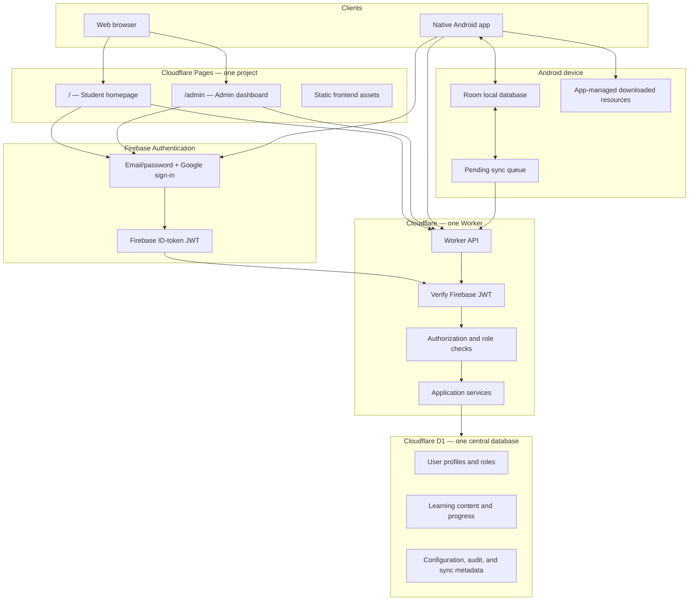
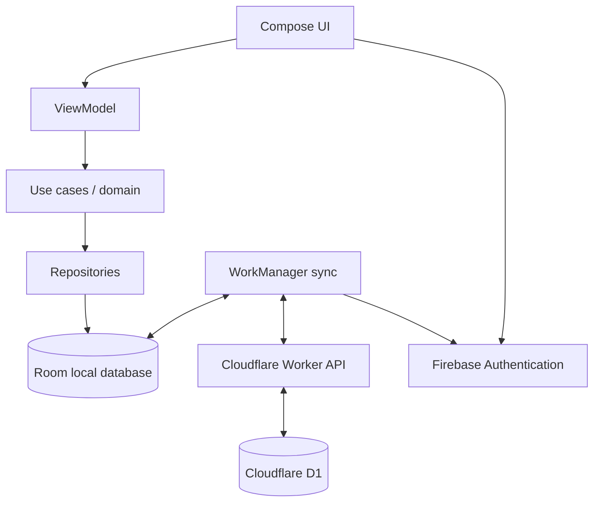

# SANZAR — Complete System Architecture Report

**Architecture status:** Recommended baseline  
**Revision:** Firebase Authentication edition  
**Date:** 23 November 2026

---

## 1. Executive decision

SANZAR will use a deliberately simple architecture that can grow without requiring an early migration to a collection of separate services.

The system consists of:

- **One Cloudflare Pages project** for the student-facing website and admin dashboard.
- **One Cloudflare Worker** for all backend/API responsibilities.
- **One Cloudflare D1 database** as the central application database.
- **Firebase Authentication** for account identity, email/password authentication, Google sign-in, and issuing Firebase ID-token JWTs.
- **A native Android application** with a local database so core learning functionality remains available offline.
- **External, on-demand resource downloads** for large optional assets and translation/model files. These are not bundled into the APK and are not stored in D1.

The architecture does not require Cloudflare R2, Firebase Firestore, Supabase, or a second backend service.

### Final architecture at a glance

| Area | Decision |
|---|---|
| Web hosting | Cloudflare Pages |
| Student homepage | `/` |
| Admin dashboard | `/admin` |
| Frontend | React + TypeScript + Vite |
| UI styling | Tailwind CSS |
| Client-side routing | React Router |
| Server-state/data fetching | TanStack Query |
| Backend | One Cloudflare Worker |
| API framework | Hono (optional, recommended for route organization) |
| Central database | Cloudflare D1 |
| Authentication | Firebase Authentication |
| Authentication methods | Email/password + Google |
| Backend token validation | Firebase ID-token JWT verification in the Worker |
| Authorization / application roles | D1 |
| Android app | Native Kotlin + Jetpack Compose |
| Android local database | Room |
| Small local preferences | DataStore |
| Background synchronization | WorkManager |
| Large optional assets | External download host, fetched on demand |
| Object storage | No Cloudflare R2 in this baseline |
| Architecture style | Offline-first Android + centralized API + hybrid data storage |
| Source control | One main source repository |
| APK distribution | Separate GitHub Releases or other release channel |

---

## 2. Core design principles

1. **Keep the first version simple.** One Pages project, one Worker, and one D1 database are enough for the initial product.
2. **Make offline learning a first-class feature.** The Android app must not require a live network connection for core learning and access to already-downloaded content.
3. **Use the local database as the Android app's operational source of truth.** The UI should read local data; synchronization updates the local database.
4. **Keep identity separate from application data.** Firebase proves who the user is. D1 stores SANZAR-specific profile, role, progress, and application records.
5. **Do not couple the application to Firebase databases.** Firebase Authentication is used for identity only; D1 remains the central database.
6. **Keep the APK small.** Do not package large dictionaries, translation models, audio packs, or AI models inside the APK unless a resource is essential to first launch.
7. **Download only what is missing.** When a supported internet connection is available, the app can check the resource manifest and download missing resources. Do not redownload resources that are already installed and valid.
8. **Make backend boundaries explicit.** Web and Android clients call the Worker API. They do not connect directly to D1.
9. **Keep authorization on the server.** A hidden admin page or a client-side role check is not a security boundary.
10. **Design for extension, not premature complexity.** Additional modules can be added inside the existing Worker and D1 schema before separate services are justified.

---

## 3. System topology



### Request flow

1. A user opens SANZAR on the web or Android.
2. The client uses the Firebase Authentication SDK to sign in or restore the existing Firebase session.
3. Firebase returns an ID token for the authenticated user.
4. The client sends that ID token to the Cloudflare Worker in the HTTPS `Authorization: Bearer <token>` header.
5. The Worker verifies the token signature and required claims using Firebase's published signing certificates.
6. The Worker reads the verified Firebase UID (`sub`) and loads the user's SANZAR profile and role from D1.
7. The Worker checks whether the requested operation is allowed.
8. The Worker reads or writes D1 and returns the result.
9. The Android app stores relevant results in Room and can continue operating offline.

**Important:** The client must never send a plain UID and expect the Worker to trust it. The Worker obtains the UID only from a successfully verified Firebase ID token.

---

## 4. Frontend architecture

### 4.1 One Cloudflare Pages project

Use one Pages project for the entire web frontend.

- `/` is the student-facing homepage.
- `/admin` is the admin dashboard.
- Shared pages such as login, registration, profile, settings, and help can live in the same application.
- Both student and admin interfaces use the same Firebase project and Worker API.

There is no need to create a separate Pages project for the admin dashboard.

### 4.2 Recommended frontend stack

| Technology | Purpose |
|---|---|
| React | Component-based UI |
| TypeScript | Type safety |
| Vite | Development server and production build |
| Tailwind CSS | Utility-first styling |
| React Router | Client-side routing |
| TanStack Query | API data fetching, caching, and mutation state |
| Firebase Web SDK | Authentication only |

This stack is widely supported and keeps the frontend independent of the backend implementation.

### 4.3 Suggested route map

| Route | Purpose | Access |
|---|---|---|
| `/` | Student homepage/dashboard | Public shell; student features may require login |
| `/login` | Sign in | Public |
| `/register` | Create account | Public |
| `/forgot-password` | Password recovery | Public |
| `/profile` | User profile | Authenticated |
| `/learn` | Learning experience | Guest/local or authenticated, depending on feature |
| `/dictionary` | Dictionary | Guest/local or authenticated |
| `/settings` | User settings | Authenticated or local |
| `/admin` | Admin dashboard | Admin role required |
| `/admin/users` | User administration | Admin role required |
| `/admin/content` | Content management | Admin role required |
| `/admin/reports` | Reports and analytics | Authorized staff role |

The route guard is a user-experience feature only. Every protected API operation must independently verify the token and check permissions on the Worker.

### 4.4 Suggested frontend structure

```text
apps/
  web/
    src/
      app/
        router.tsx
        providers.tsx
      components/
      features/
        auth/
        dashboard/
        learning/
        dictionary/
        profile/
        admin/
      lib/
        firebase.ts
        api-client.ts
        query-client.ts
      hooks/
      styles/
      main.tsx
    public/
    index.html
    vite.config.ts
```

Keep Firebase client configuration in environment variables/build-time configuration. Firebase web configuration is not a server secret, but the Worker must still validate every ID token and enforce access controls.

---

## 5. Authentication — Firebase Authentication

### 5.1 Final provider decision

**Use Firebase Authentication instead of Supabase Auth.**

Firebase is responsible for:

- Email/password account creation and sign-in.
- Google sign-in.
- Password reset and email verification flows.
- Client session persistence and refresh.
- Issuing Firebase ID tokens (JWTs).
- Managing authentication identity and provider-linked accounts.

Firebase Authentication is not responsible for:

- SANZAR learning progress.
- SANZAR roles and permissions.
- Course or vocabulary records.
- Rankings or application-specific statistics.
- Offline learning data.
- The central application database.

Those responsibilities remain with the Worker, D1, and Android Room.

Official documentation:
- Firebase Authentication: https://firebase.google.com/docs/auth
- Firebase Android setup: https://firebase.google.com/docs/android/setup
- Verify Firebase ID tokens: https://firebase.google.com/docs/auth/admin/verify-id-tokens

### 5.2 Sign-in methods

Enable these providers in the Firebase Console:

1. **Email/password**
   - Account registration.
   - Email/password sign-in.
   - Password reset.
   - Email verification where required by product policy.

2. **Google**
   - Google account sign-in on Android.
   - Google sign-in on the web.
   - Link Google credentials to an existing account where appropriate.

Do not add phone/SMS authentication to the first release unless there is a clear product requirement. Phone verification has separate SMS costs and abuse/region constraints.

### 5.3 Firebase ID token, not the Google provider token

For requests to SANZAR's backend, send the **Firebase ID token** obtained from the Firebase Authentication user session.

Do not send:
- A plain Firebase UID as proof of identity.
- A Google OAuth access token as if it were a Firebase ID token.
- A Firebase custom token as if it were an ID token.

A Firebase ID token is a signed JWT representing the authenticated Firebase user. The Worker validates it and uses its verified UID.

### 5.4 Worker-side token verification

The Cloudflare Worker should verify Firebase ID tokens using a maintained JWT/JWKS or X.509 verification library compatible with the Workers runtime.

Firebase's documented ID-token verification requirements include:

| Check | Expected value / rule |
|---|---|
| Signature algorithm | `RS256` |
| Signing key | `kid` must match a current Firebase Secure Token signing certificate |
| Key source | `https://www.googleapis.com/robot/v1/metadata/x509/securetoken@system.gserviceaccount.com` |
| `aud` | Exactly the SANZAR Firebase project ID |
| `iss` | `https://securetoken.google.com/<projectId>` |
| `sub` | Non-empty Firebase UID |
| `exp` | Must be in the future |
| `iat` | Must be valid and not in the future |
| `auth_time` | Must be a valid past authentication time |

The Worker should cache signing certificates according to the upstream `Cache-Control` max-age and refresh them when required. Do not fetch signing certificates on every API request.

**Do not merely decode a JWT.** Decoding is not verification. A token is trusted only after its signature and claims have been validated.

### 5.5 Do not put a Firebase service-account private key in the Worker

For ordinary Firebase ID-token verification, the Worker can verify the token using Firebase's public signing certificates. It does not need a service-account private key.

Do not place a service-account JSON file, private key, or Admin SDK credential in:
- Frontend code.
- Android APK.
- Public repository.
- `VITE_*` or other client-exposed variables.

If a future administrative operation requires Firebase Admin privileges (for example, disabling an identity or setting custom claims), implement that as a narrowly scoped trusted server-side operation. Store any required secret securely and never expose it to clients. Do not add this complexity to the first release without a need.

### 5.6 D1 user profile mapping

Use Firebase UID as the stable external identity key.

A minimal D1 user record can include:

```sql
CREATE TABLE users (
  id TEXT PRIMARY KEY,
  firebase_uid TEXT NOT NULL UNIQUE,
  email TEXT,
  display_name TEXT,
  photo_url TEXT,
  account_status TEXT NOT NULL DEFAULT 'active',
  created_at TEXT NOT NULL DEFAULT CURRENT_TIMESTAMP,
  updated_at TEXT NOT NULL DEFAULT CURRENT_TIMESTAMP,
  last_seen_at TEXT
);
```

Use the verified Firebase UID as `firebase_uid`. The Worker can create a SANZAR profile on the user's first authenticated API request.

The email and display name are profile attributes, not authorization proof. Refresh them from verified token claims or a trusted profile update flow, and validate user-editable profile fields.

### 5.7 Roles and permissions

Keep SANZAR roles in D1, not only in frontend state.

Example:

```sql
CREATE TABLE user_roles (
  user_id TEXT NOT NULL,
  role TEXT NOT NULL,
  created_at TEXT NOT NULL DEFAULT CURRENT_TIMESTAMP,
  PRIMARY KEY (user_id, role),
  FOREIGN KEY (user_id) REFERENCES users(id)
);
```

Possible roles:

- `student`
- `content_editor`
- `moderator`
- `admin`
- `super_admin`

The Worker must check the user's role for every privileged operation. Hiding the `/admin` route is not enough.

**Recommended authority model:** D1 is the source of truth for SANZAR roles. Firebase proves identity; D1 determines what that identity is allowed to do in SANZAR.

This avoids needing to synchronize every role change into Firebase custom claims. If custom claims are added later, treat them as supplementary authorization metadata and account for token refresh/propagation.

### 5.8 First super-admin provisioning

Do not allow public registration to choose an admin role.

Provision the first `super_admin` through a controlled one-time setup process:
1. Create the account through Firebase Authentication.
2. Obtain its Firebase UID.
3. Insert the corresponding user record and `super_admin` role through a trusted migration/administrative procedure.
4. Remove or disable the one-time bootstrap mechanism.
5. Audit subsequent role changes.

No client request may promote itself or another user to an administrator.

### 5.9 Guest and local-only use

SANZAR should preserve local learning functionality without forcing account creation.

Suggested behavior:

- A user can begin supported learning activities without signing in.
- Guest progress is stored locally in Room.
- Signing in enables account-linked features such as cross-device sync, shared rankings, and other server-backed features.
- When a guest signs in, offer a controlled merge/import of local progress into the account.
- Never silently overwrite newer server data with stale local data.

A guest does not need a Firebase anonymous account unless a specific backend feature requires a server-recognized temporary identity. Local-only guest mode is simpler and avoids unnecessary account records.

### 5.10 Token lifecycle

- Let the Firebase SDK manage normal client session persistence and ID-token refresh.
- Obtain a current ID token from the signed-in Firebase user before authenticated API calls.
- Send the token over HTTPS in the Authorization header.
- Do not store ID tokens in application logs, analytics events, URLs, or local plaintext files.
- On sign-out, clear the local authenticated session state and any account-specific sensitive cached data as appropriate.
- Handle expired or invalid tokens by asking the Firebase SDK for a refreshed token/session and retrying safely once.

Firebase ID tokens are short-lived (normally about one hour). A verified token is not the same as an immediate revocation check: a token that has not expired may remain cryptographically valid after an account is disabled or a session is revoked. For ordinary application requests, short-lived ID tokens may be sufficient. If SANZAR later requires immediate revocation enforcement for sensitive operations, add a deliberate revocation/status-check strategy rather than assuming signature verification alone detects revocation.

### 5.11 Firebase plan and cost considerations

Firebase offers a no-cost Spark plan and a pay-as-you-go Blaze plan. Current published quotas and eligibility can change, so check the Firebase pricing page and the project's Authentication usage before launch.

Important distinctions:
- Email/password and common federated sign-in methods have different billing/usage rules from phone/SMS authentication.
- Phone authentication is billed per SMS and should not be assumed free.
- Firebase's current pricing and Identity Platform quota presentation includes a 50,000 monthly active user no-cost allowance for applicable authentication usage; separate daily operational limits and plan eligibility may also apply.
- Abuse protections, account-creation limits, email quotas, and regional/provider requirements still matter.

References:
- https://firebase.google.com/pricing/
- https://firebase.google.com/docs/auth/limits

Do not build the product around an assumed unlimited free tier. Monitor usage and configure budget alerts if/when the project uses a billable plan.

---

## 6. Backend architecture — one Cloudflare Worker

### 6.1 Responsibility

Use one Worker as the single backend entry point for both web and Android clients.

The Worker handles:
- Firebase ID-token verification.
- D1 access.
- User profile creation and updates.
- Role and permission checks.
- Learning progress synchronization.
- Dictionary/content API.
- Rankings and shared statistics.
- Admin APIs.
- Resource manifest delivery.
- Sync conflict handling.
- Rate limiting and request validation.
- Audit events for sensitive operations.

There is no need to split these into multiple Workers in the initial architecture.

### 6.2 API organization

A single Worker can contain many modules and route groups. One Worker does not mean one giant source file.

Suggested API route groups:

| Prefix | Responsibility |
|---|---|
| `/api/v1/me` | Current user/profile |
| `/api/v1/profile` | Profile changes |
| `/api/v1/learning` | Learning content and progress |
| `/api/v1/dictionary` | Dictionary metadata/search |
| `/api/v1/sync` | Android synchronization |
| `/api/v1/rankings` | Shared rankings |
| `/api/v1/resources` | Resource manifests and metadata |
| `/api/v1/admin/users` | User administration |
| `/api/v1/admin/content` | Content administration |
| `/api/v1/admin/reports` | Admin reporting |
| `/api/v1/health` | Health/status endpoint |

Example route structure:

```text
apps/
  worker/
    src/
      index.ts
      app.ts
      middleware/
        firebase-auth.ts
        authorization.ts
        rate-limit.ts
        error-handler.ts
      routes/
        me.ts
        profile.ts
        learning.ts
        dictionary.ts
        sync.ts
        rankings.ts
        resources.ts
        admin/
          users.ts
          content.ts
          reports.ts
      services/
      repositories/
      validators/
      types/
    wrangler.toml
```

Hono is a suitable lightweight routing framework, but it is not mandatory. The architecture works with the native Worker request handler as well.

### 6.3 Request middleware order

For protected API routes, use a consistent pipeline:

1. Validate request method, path, and basic size limits.
2. Read the Bearer token.
3. Verify Firebase ID-token signature and claims.
4. Extract the verified Firebase UID.
5. Load or create the SANZAR user profile.
6. Load roles/permissions from D1 when needed.
7. Validate request body and resource ownership.
8. Execute application service logic.
9. Write required audit/sync records.
10. Return a minimal response.

Public routes such as health checks and public resource manifests can use a separate, explicit public policy.

### 6.4 Security rules

- Never expose D1 credentials or privileged bindings to the browser or APK.
- Never trust a client-supplied `user_id`, `role`, `is_admin`, score, or ownership claim.
- Derive identity from the verified Firebase UID.
- Use parameterized SQL statements.
- Validate all request bodies and query parameters.
- Apply per-user and per-IP rate limits to sensitive endpoints.
- Restrict CORS to known production origins where practical; CORS is not authentication.
- Use HTTPS only.
- Avoid returning stack traces or internal database errors.
- Keep secrets in Worker secrets/environment bindings, not source control.
- Log security-relevant events without logging passwords, raw tokens, or sensitive personal data.
- Add idempotency keys for operations that may be retried by mobile clients.

---

## 7. Central database — Cloudflare D1

### 7.1 One central D1 database

D1 is the central database for shared SANZAR data.

It stores:
- User profiles linked to Firebase UID.
- Roles and permissions.
- Shared learning content and metadata.
- Account-linked learning progress.
- Rankings and shared statistics.
- Resource manifests and version metadata.
- Sync cursors and idempotency records.
- Administrative configuration.
- Audit events.

Android's Room database is a local device database, not a second cloud database.

### 7.2 Suggested schema domains

Keep tables grouped by responsibility. The following is a logical schema outline; implement only tables required by the first release.

**Identity and access**
- `users`
- `user_roles`
- `role_permissions` (optional)
- `admin_audit_logs`

**Learning**
- `courses`
- `lessons`
- `learning_items`
- `user_progress`
- `review_sessions`
- `learning_events` (if detailed event history is required)

**Dictionary**
- `dictionary_entries`
- `dictionary_translations`
- `dictionary_metadata`

**Synchronization**
- `sync_operations`
- `sync_cursors`
- `idempotency_keys`
- `device_installations` (only if device tracking is needed)

**Resources**
- `resource_manifest`
- `resource_versions`
- `resource_platform_compatibility`

**Application**
- `app_config`
- `feature_flags`
- `announcements`

Avoid creating a large number of tables before the product needs them. Normalize relational data where it improves integrity; use JSON only for genuinely flexible payloads, not as a substitute for a coherent schema.

### 7.3 D1 data rules

- Use stable primary keys.
- Add indexes for frequent filters and joins.
- Use foreign keys where appropriate.
- Use transactions for logically atomic updates.
- Store timestamps consistently, preferably UTC ISO 8601 or integer epoch values.
- Add `created_at` and `updated_at` to mutable records.
- Use migrations committed to the source repository.
- Keep large binary resources out of D1.
- Paginate large result sets.
- Avoid loading a full user's event history for every screen.

### 7.4 D1 plan limits

Cloudflare's published D1 limits distinguish per-database and account-wide storage:

- Free plan: up to **500 MB per database**, with **5 GB total account storage**.
- Paid plan: up to **10 GB per database**, with higher account-wide capacity.
- D1 also has daily read/write quotas on the Free plan.
- Individual row/BLOB/string limits and query/runtime constraints apply.

Limits and pricing can change; check the current official pages before deployment decisions:
- https://developers.cloudflare.com/d1/platform/limits/
- https://developers.cloudflare.com/d1/platform/pricing/

Design for efficient queries and monitor storage/usage. Do not assume D1 is an unlimited file store.

---

## 8. Android application architecture

### 8.1 Native Android stack

| Technology | Purpose |
|---|---|
| Kotlin | Main programming language |
| Jetpack Compose | UI |
| AndroidX ViewModel | UI state and lifecycle |
| Room | Local relational database |
| DataStore | Small preferences/settings |
| WorkManager | Deferred/retryable background sync and downloads |
| Kotlin Coroutines + Flow | Asynchronous operations and observable state |
| Firebase Authentication SDK | Sign-in and session management |
| OkHttp or Ktor Client | Worker API networking |
| Kotlin Serialization | Typed API payload serialization |
| R8 | Release code/resource shrinking |

Use a layered architecture with UI, domain/use-case, and data layers. Avoid putting database/network logic directly inside Compose screens.

### 8.2 Android data flow



### 8.3 Room is the local source of truth

The Android UI should observe Room data. Network responses should update Room; the UI then reacts to the database change.

Benefits:
- Learning remains available offline.
- The app can open quickly without waiting for API requests.
- Network interruptions do not destroy in-progress work.
- Pending changes can be synchronized later.
- The app has one consistent data source for local screens.

Use DataStore for small preferences such as theme, selected language, or user interface settings. Do not use DataStore as a replacement for Room when storing relational learning records.

### 8.4 Offline-first behavior

- Read available learning content from Room.
- Save user answers/progress locally first.
- Mark account-linked mutations as pending sync when the user is authenticated.
- Retry synchronization when connectivity returns.
- Keep guest progress local until the user chooses to sign in or export/merge it.
- Make API mutations idempotent so a retry cannot accidentally create duplicate progress events.
- Handle conflicts explicitly instead of blindly overwriting local or server records.

### 8.5 Synchronization strategy

A simple initial sync flow:

1. Android records a local mutation with a unique operation ID.
2. The mutation is stored in Room and marked `pending`.
3. WorkManager schedules synchronization.
4. The worker obtains a current Firebase ID token from the Firebase SDK.
5. It sends pending operations to `/api/v1/sync`.
6. The Cloudflare Worker verifies the token and derives the account UID.
7. The Worker validates ownership, operation IDs, and payloads.
8. The Worker applies accepted changes to D1 in a transaction.
9. The Worker returns accepted/rejected operations and the latest server cursor.
10. Android marks accepted operations as synced and applies server updates to Room.

Do not make every UI action wait for the server. Use optimistic local persistence for normal learning actions, with visible sync status where appropriate.

### 8.6 Conflict handling

Start with clear rules:
- Immutable learning events: append using unique operation IDs; duplicates are ignored.
- Mutable profile settings: use explicit last-updated/version rules.
- Learning progress summaries: derive from events or use a versioned merge strategy.
- Admin-edited shared content: server is authoritative.
- Resource manifests: server is authoritative for latest version; local files remain usable until a valid replacement is downloaded.

Do not use a single blanket “last write wins” rule for all data.

---

## 9. APK size and resource delivery

### 9.1 Keep the APK small

Do not bundle large optional resources into the APK:
- Translation models.
- Large dictionaries if they can be installed after first launch.
- Audio packs.
- Optional image packs.
- AI model files.
- Additional language packs.

Include only what is necessary for installation, first launch, core UI, and a usable initial experience.

Use Android App Bundle or ABI-specific release packaging where appropriate, and enable R8/code/resource shrinking for release builds.

### 9.2 Resource manifest approach

The Worker should expose a resource manifest that tells the Android app:
- Resource identifier.
- Version.
- Download URL.
- File size.
- SHA-256 checksum.
- Supported app/platform version.
- Optional language/model metadata.
- Whether the resource is mandatory or optional.

Example conceptual response:

```json
{
  "resources": [
    {
      "id": "translation-en-bn",
      "version": "1.2.0",
      "url": "https://downloads.example.com/models/en-bn-1.2.0.bin",
      "sizeBytes": 123456789,
      "sha256": "REPLACE_WITH_REAL_SHA256",
      "required": false
    }
  ]
}
```

The example URL and checksum are placeholders, not a real download location or checksum.

### 9.3 Download behavior

- Check the manifest when online.
- Compare the required version with installed resources.
- Download only missing or outdated resources.
- Do not download an already-installed valid file again.
- Verify SHA-256 before marking a resource installed.
- Download to a temporary file, then atomically move it into its final location after verification.
- Resume/retry where the chosen download mechanism supports it.
- Display download size and progress for large resources.
- Allow users to manage optional downloads where storage is relevant.

The intended product behavior is to automatically download missing translation models whenever a usable internet connection is available, including mobile data, subject to Android background/network constraints and the user's applicable settings. Existing valid models must not be downloaded again.

### 9.4 Persistent storage versus cache

A critical distinction:

- Use app-specific persistent files for models/resources that must remain available offline.
- Use cache directories only for temporary, re-creatable files.
- The operating system may delete cache files to reclaim storage.
- Keep a local manifest/database record of installed resource version and checksum.
- On startup or before use, confirm that the file still exists and matches the expected resource metadata.

### 9.5 No R2: where large files live

The architecture excludes Cloudflare R2. Therefore:
- Do not store large model binaries in D1.
- Do not package large models in the Pages static site.
- Do not route large binary downloads through the Worker unless there is a specific reason and the size/bandwidth constraints have been evaluated.
- Use a suitable external file/release host for large downloads (for example, GitHub Releases or a dedicated model distribution host).
- Store only resource metadata/manifests in D1.
- The Worker can return a trusted manifest or signed/controlled download information; the Android client downloads the binary directly from the external host.

Cloudflare Pages has a published maximum individual asset size of 25 MiB. It is not a suitable default host for large translation/AI model files. See https://developers.cloudflare.com/pages/platform/limits/.

External download hosting should be selected based on file size, bandwidth, access control, versioning, geographic availability, and terms of service. Do not assume GitHub Releases is the final answer for high-volume production distribution without checking its current limits and policies.

---

## 10. Repository and project organization

Use one main source repository for the application source and deployment configuration. Keep downloadable APK releases separate from the normal source/frontend deployment channel.

Suggested monorepo:

```text
sanzar/
  apps/
    web/
    worker/
    android/
  packages/
    shared-types/
    api-contracts/
    validation/
  database/
    migrations/
    seeds/
  resources/
    manifests/
  docs/
    architecture/
    api/
  .github/
    workflows/
  README.md
```

The APK can be attached to GitHub Releases (or another release channel) without turning the release binaries into the source repository's primary deployment artifact.

Keep shared API contracts and TypeScript types in a package where useful. Android can maintain matching Kotlin DTOs; if code generation is introduced later, keep the contract as the source of truth.

---

## 11. Deployment responsibilities

### 11.1 Cloudflare Pages

Deploy the React frontend to one Pages project.

- Build command: `npm run build` (or the monorepo-specific equivalent).
- Build output: Vite's `dist` directory.
- Configure SPA fallback/routing so `/admin` and other client-side routes load correctly.
- Configure production environment values for Firebase web configuration and Worker API base URL.

### 11.2 Cloudflare Worker

Deploy one Worker with:
- D1 database binding.
- Environment variables such as Firebase project ID.
- Secret bindings only when truly needed.
- API routes and Firebase JWT verification middleware.
- Database migrations run as a controlled deployment step.

A Pages deployment and Worker deployment can be managed from the same repository. The Pages project remains the frontend host; the Worker remains the backend API.

### 11.3 D1 migrations

- Keep SQL migrations in source control.
- Apply migrations to development/staging before production.
- Back up important data and test restoration procedures.
- Never rely on a developer's local database state as the production schema.
- Keep migration changes backward-compatible where possible during rolling deployments.

### 11.4 Environment separation

At minimum, use separate development and production configuration:
- Firebase development project and production project (recommended).
- D1 development database and production database.
- Worker development and production variables.
- Separate web origins/allowed CORS origins.
- Separate release channels.

Avoid testing destructive schema changes against production data.

---

## 12. Security model

### 12.1 Trust boundaries

| Component | Trust level | Rule |
|---|---|---|
| Browser | Untrusted client | Never trust client-supplied roles or ownership |
| Android APK | Untrusted client | APK can be inspected or modified |
| Firebase Authentication | Identity authority | Verify its ID tokens |
| Cloudflare Worker | Trusted application backend | Enforce validation and authorization |
| D1 | Trusted central data store | Accessible through controlled backend binding |
| External download host | Resource delivery | Verify checksums and validate manifests |

### 12.2 Authentication versus authorization

Authentication answers: **Who is this user?**

Authorization answers: **What may this user do?**

Firebase Authentication handles the first. The Worker and D1 handle the second.

A valid Firebase ID token does not automatically make someone an admin, content editor, or owner of a particular record.

### 12.3 Admin protection

- Check the D1 role on every admin API operation.
- Use a least-privilege role model.
- Require stronger confirmation for destructive operations.
- Record role changes and sensitive admin actions in an audit table.
- Do not expose admin-only data in public API responses.
- Do not use a frontend-only admin flag.
- Consider multi-factor authentication for privileged accounts if supported and appropriate.

### 12.4 Abuse protection

Add:
- Rate limits on registration-related and expensive endpoints.
- Request body size limits.
- Input validation.
- Pagination and query limits.
- Idempotency for retried writes.
- Abuse monitoring for resource downloads and public endpoints.
- App Check as a possible additional signal, not a replacement for authentication or authorization.

---

## 13. Observability and operational maintenance

Monitor:
- Worker request count, errors, and latency.
- D1 query errors and storage usage.
- Authentication sign-in failures and provider issues.
- Sync queue age and failure rate.
- Resource download failures and checksum mismatches.
- Android crashes and app startup performance.

Do not log raw Firebase ID tokens, passwords, reset links, or other credentials.

Use structured logs with request IDs and operation IDs. Keep user data in logs to the minimum needed for debugging and security.

---

## 14. Scaling path

Do not split the system into multiple services at the beginning.

Scale in this order:

1. Improve D1 indexes and query efficiency.
2. Add pagination and reduce unnecessary API calls.
3. Batch Android sync operations.
4. Cache safe, public, relatively static content.
5. Move large downloads to a dedicated external file host/CDN.
6. Add queue/background processing only when a workload requires it.
7. Split a backend responsibility into a separate service only when operational or scaling evidence justifies it.
8. Consider a different database only when measured workload or product requirements exceed D1's practical limits.

The initial architecture can support new features by adding Worker route modules, service modules, and D1 tables without adding another backend deployment for every feature.

---

## 15. Backup and recovery

- Use D1 backup/export capabilities appropriate to the selected plan and operational needs.
- Keep regular exports of important central data.
- Test restoration, not merely backup creation.
- Keep schema migrations and seed data in version control.
- Make user progress recoverable through central sync once authenticated.
- Keep local Room data resilient to app upgrades; use explicit Room migrations.
- Provide a user-facing export mechanism if user data portability is a product requirement.

Do not treat Android local storage as the only copy of account-linked progress after successful synchronization.

---

## 16. Implementation sequence

A practical implementation order:

### Phase 1 — Foundation
- Create the repository structure.
- Create one Cloudflare Pages project.
- Create one Cloudflare Worker.
- Create one D1 database.
- Configure development and production environments.
- Establish migrations and deployment workflow.

### Phase 2 — Firebase Authentication
- Create the Firebase project.
- Register the Android and web applications.
- Enable email/password and Google providers.
- Configure authorized domains and Google sign-in settings.
- Integrate Firebase SDK in web and Android.
- Implement Worker Firebase ID-token verification.
- Create the D1 user profile on first authenticated request.
- Add D1 role checks and secure super-admin provisioning.

### Phase 3 — Core web application
- Implement `/` student homepage.
- Implement `/admin` dashboard shell.
- Implement login, registration, password reset, and profile pages.
- Add API client and authenticated request handling.
- Enforce admin access on Worker routes.

### Phase 4 — Android offline foundation
- Build the Compose application shell.
- Add Room entities/DAOs.
- Implement local learning flows.
- Add Firebase Authentication.
- Add Worker API client.
- Add WorkManager synchronization and retry behavior.

### Phase 5 — Shared features
- Implement D1-backed user progress.
- Implement sync endpoints and idempotency.
- Implement rankings and other account-linked features.
- Add conflict handling and sync status.

### Phase 6 — Resource delivery
- Implement resource manifests.
- Select an external file host.
- Implement on-demand downloads.
- Verify SHA-256 checksums.
- Store installed models in persistent app-specific storage.
- Test mobile-data and Wi-Fi download behavior.

### Phase 7 — Hardening and release
- Add rate limiting and audit logging.
- Test invalid/expired Firebase tokens.
- Test guest-to-account progress merge.
- Test offline and interrupted synchronization.
- Test D1 backup/restore.
- Minimize release APK size.
- Publish APK through a separate release channel.

---

## 17. Acceptance criteria

The baseline architecture is ready when:

### Web
- `/` loads the student homepage.
- `/admin` loads the admin interface.
- A non-admin cannot access admin API operations, even if they manually call the API.
- Both interfaces use the same Worker API and Firebase project.

### Authentication
- Email/password registration and login work.
- Google sign-in works on web and Android.
- The Worker rejects missing, malformed, expired, incorrectly signed, wrong-audience, or wrong-issuer tokens.
- The Worker derives identity from the verified Firebase UID.
- No Firebase service-account private key is shipped to clients.
- D1 roles, not frontend state, determine SANZAR permissions.
- Firebase Authentication is not coupled to Firestore.

### Android
- Core learning works without a network connection after required content is installed.
- Learning changes persist in Room.
- Pending sync survives app restarts.
- WorkManager retries failed synchronization.
- Duplicate retries do not create duplicate server records.
- A guest can learn locally and later choose to sign in.
- A signed-in user can synchronize account-linked progress.

### Resources and APK
- Large optional models are not bundled into the APK.
- The app downloads only missing/outdated resources.
- A valid installed resource is not downloaded again.
- Downloads are checksum-verified.
- Offline-required resources are stored persistently, not only in cache.
- Large files are hosted outside D1 and outside Pages assets when they exceed Pages' asset constraints.

### Operations
- There is one Pages project, one Worker, and one D1 database in the baseline.
- Database migrations are version-controlled.
- Production data can be backed up and restored.
- Logs do not expose credentials or raw ID tokens.

---

## 18. Final architecture decision table

| Decision | Final choice | Why |
|---|---|---|
| Frontend hosting | Cloudflare Pages | Simple static frontend deployment |
| Web application | React + TypeScript + Vite | Maintainable, widely supported |
| Student/admin structure | One app, `/` and `/admin` | Avoid duplicated frontend deployments |
| Backend | One Cloudflare Worker | One API and authorization boundary |
| API routing | Hono or native Worker routing | Modular route organization |
| Central database | One Cloudflare D1 | Shared application data |
| Authentication | Firebase Authentication | Native Android/web SDKs, email/password and Google, Firebase ID tokens |
| Token verification | Firebase ID-token verification in Worker | Backend verifies identity independently of client |
| Application roles | D1 | SANZAR controls its own authorization |
| Android | Native Kotlin + Compose | Native application and maintainable UI |
| Offline database | Room | Reliable local relational storage |
| Preferences | DataStore | Lightweight settings storage |
| Background work | WorkManager | Retryable sync and downloads |
| Large resources | External download host | Keep APK small and avoid D1/Pages binary limits |
| Cloud object storage | No R2 | Not required for this baseline |
| Firebase database | Not used | D1 remains the only central application database |
| Source repository | One main repository | Keep application source and infrastructure together |
| APK distribution | Separate release channel | Keep binaries separate from normal source deployment |

---

## 19. Important implementation notes

1. **Firebase Authentication is not Firebase Firestore.** You can use Firebase for authentication without adopting any Firebase database.
2. **Firebase ID tokens are JWTs.** The Worker must verify their signature and claims; merely decoding them is insecure.
3. **Do not trust a client-provided UID.** Always derive the UID from the verified token.
4. **D1 owns SANZAR roles.** Firebase identity does not automatically grant application privileges.
5. **One Worker can contain many modules.** There is no need to create multiple Workers just to keep code organized.
6. **Room is not a second central database.** It is the Android device's offline database.
7. **Large models do not belong in the APK or D1.** Deliver them as versioned, checksum-verified downloads.
8. **Do not use cache storage for required offline models.** Store them in persistent app-specific files.
9. **Keep guest mode local-first.** Require authentication only for features that need an account or shared server state.
10. **Review Firebase pricing and quotas before launch.** In particular, phone/SMS authentication has separate billing rules.

---

## 20. Official technical references

### Firebase
- Firebase Authentication overview: https://firebase.google.com/docs/auth
- Firebase Android setup: https://firebase.google.com/docs/android/setup
- Firebase web setup: https://firebase.google.com/docs/web/setup
- Verify Firebase ID tokens: https://firebase.google.com/docs/auth/admin/verify-id-tokens
- Firebase Authentication limits: https://firebase.google.com/docs/auth/limits
- Firebase pricing: https://firebase.google.com/pricing/

### Cloudflare
- Cloudflare Pages limits: https://developers.cloudflare.com/pages/platform/limits/
- Cloudflare Workers limits: https://developers.cloudflare.com/workers/platform/limits/
- D1 limits: https://developers.cloudflare.com/d1/platform/limits/
- D1 pricing: https://developers.cloudflare.com/d1/platform/pricing/
- D1 migrations: https://developers.cloudflare.com/d1/reference/migrations/

### Android
- Android architecture recommendations: https://developer.android.com/topic/architecture/recommendations
- Offline-first data layer: https://developer.android.com/topic/architecture/data-layer/offline-first
- Room: https://developer.android.com/training/data-storage/room
- DataStore: https://developer.android.com/topic/libraries/architecture/datastore
- WorkManager: https://developer.android.com/topic/libraries/architecture/workmanager
- Jetpack Compose: https://developer.android.com/compose

---

## Final recommendation

Proceed with the architecture in this report:

**Cloudflare Pages + one Cloudflare Worker + one D1 database + Firebase Authentication + native Kotlin Android app with Room.**

Firebase handles authentication and issues the ID-token JWT. The Worker verifies that JWT and enforces SANZAR permissions. D1 remains the central application database, while Room supports offline Android use. Large optional resources are downloaded on demand from an external host.

This changes the authentication provider only. It does not require changing the rest of the agreed SANZAR architecture.
